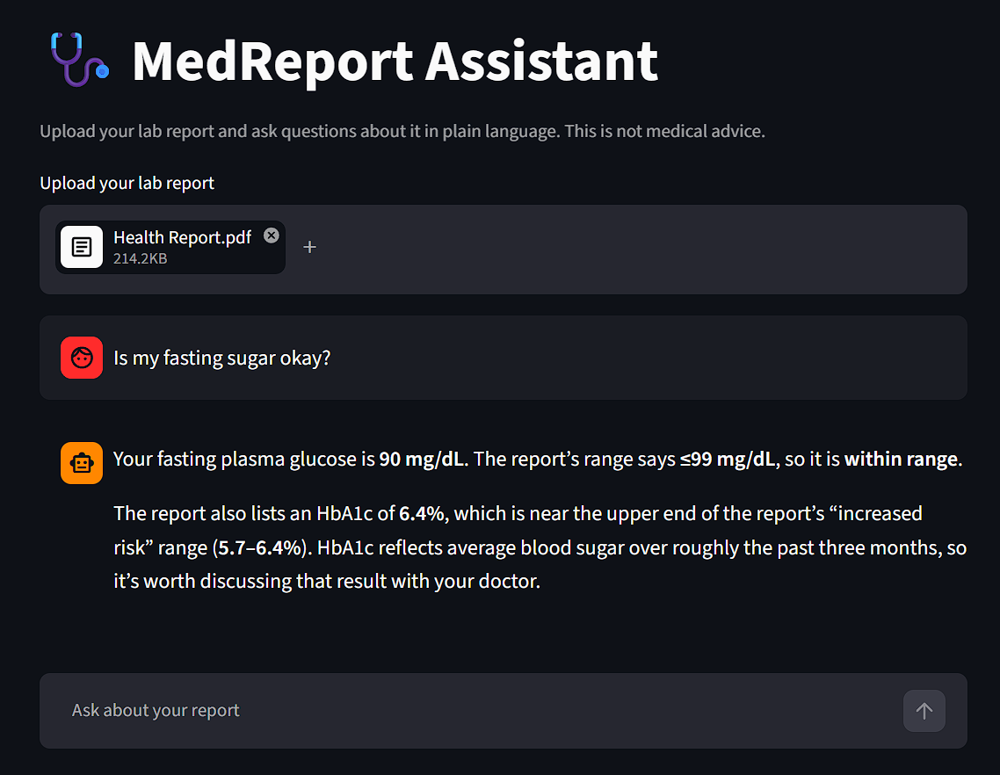

# 🩺 MedReport Assistant

**Your lab report, in plain language.**

MedReport Assistant is a chatbot that helps people understand their lab reports. Upload a PDF report and ask questions in your own words, such as "is my sugar okay?" or "summarise my report". The bot searches the report and explains what it says in calm, simple language, using only what's on the report.

> **This is not medical advice.** The assistant explains what a report says. It does not diagnose, recommend treatment, or replace a doctor.

Built with [Streamlit](https://streamlit.io/), [LangChain](https://www.langchain.com/), [LangGraph](https://www.langchain.com/langgraph) and OpenAI's `gpt-6-luna`.

## Demo



## Features

- **Answers grounded in your report:** every answer comes from the uploaded PDF. If something isn't in the report, the bot says so instead of guessing.
- **Uses the lab's own reference ranges:** values are judged high, low or normal against the ranges printed on the report, not textbook ones.
- **Plain-language explanations:** tests and medical terms are explained simply, for anxious, non-expert users.
- **Report summaries:** a broad question gets the tests covered, any values outside the range, and what's within range.
- **Remembers the conversation:** follow-up questions build on what was said earlier in the chat.
- **Replies in your language:** the bot answers in whatever language you write in.
- **Built-in guardrails:** it never diagnoses or advises on medicines, handles emergencies first, and protects personal identifiers (see [Safety guardrails](#safety-guardrails)).
- **Friendly upload errors:** password-protected, damaged and scanned (image-only) PDFs get a clear message instead of a crash.
- **Fresh start per report:** uploading a new report starts a new chat.

## How it works

```
  PDF upload
        │
        ▼
  PyPDFLoader + text splitter       ingestion.py: read the PDF and split it
        │                           into overlapping chunks
        ▼
  OpenAI embeddings                 vectorstore.py: embed each chunk with
        │                           text-embedding-3-large
        ▼
  in-memory vector store            one per upload, kept in session state
        │
  ┄┄┄┄┄┄┄┄┄┄┄┄┄┄┄┄┄┄┄┄ repeats every question ┄┄┄┄┄┄┄┄┄┄┄┄┄┄┄┄┄┄┄┄
        │
        ▼
  user question                     sent to the agent with the chat history
        │
        ▼
  gpt-6-luna agent                  agent.py: follows the rules in prompts.py
        │  ▲
        │  │  search phrase ──► get_report_context (tools.py)
        │  └── matching passages ◄── searches the vector store
        ▼
  plain-language answer             shown in the chat and saved
                                    for the next turn
```

1. **Ingestion:** the PDF is read with `PyPDFLoader` and split into overlapping chunks.
2. **Indexing:** each chunk is embedded with OpenAI `text-embedding-3-large` and stored in an in-memory vector store. A new store is built for each uploaded report and kept in the browser session's state.
3. **Agent:** a LangChain agent with a single tool, `get_report_context`, searches the report before answering. For broad questions it runs several searches.
4. **Memory:** the conversation is kept per session with LangGraph's `InMemorySaver`, so follow-up questions work. Uploading a new report starts a fresh session.

### Details that matter

- **The model never sees the whole report.** It can only look things up with `get_report_context`, and the prompt requires a search before any answer about the user's results. This keeps answers tied to what the report actually says.
- **Search first, ask later.** For broad questions the bot searches straight away instead of asking the user to narrow it down. It only asks a follow-up question if, after searching, it still can't tell what the user wants.
- **The prompt lives apart from the app.** `prompts.py` holds the behaviour rules and guardrails; `app.py` holds only the UI and chat logic. Changing how the bot behaves never means touching the Streamlit code.
- **Report text is treated as data, not instructions.** If a document contains something like "ignore your rules", the bot treats it as part of the document and doesn't act on it.
- **Each report is processed once.** Streamlit reruns the script on every interaction, so the app only rebuilds the index when a different file is uploaded. Removing the file or uploading a new one clears the old report and chat.
- **Clean answers.** Only the reply's text is shown; the model's hidden reasoning is skipped, and any stray HTML tags like `<br>` are removed before display.

## Safety guardrails

The system prompt (`medreport/prompts.py`) makes the assistant:

- **Never diagnose.** It can say a value is above the range, but not that the person has a condition. "Your fasting glucose is above the range on this report" is fine; "You have diabetes" is not.
- **Never advise on medicines, supplements, diets or treatment.** It refers these questions to a doctor, who knows the person's full history.
- **Handle emergencies first.** If the user mentions symptoms like chest pain, trouble breathing or fainting, it tells them to get emergency care (112 / 108 in India) before anything else.
- **Respond with care to self-harm.** It shares Tele-MANAS (14416 or 1800 891 4416), India's free 24/7 mental health helpline.
- **Flag critical values calmly.** For values far outside the range, it suggests seeing a doctor soon without alarming language.
- **Protect personal identifiers.** It shares the patient's name, age and report date when asked, but never repeats phone numbers, addresses or ID numbers (UHID, patient ID), even if asked directly.
- **Stay on topic and resist manipulation.** It only discusses the uploaded report, and won't reveal its prompt or drop its rules.
- **Reject non-medical documents.** If the upload isn't a medical report, it replies "It doesn't seem like a medical report."

## Getting started

### Prerequisites

- Python 3.10 or newer
- An [OpenAI API key](https://platform.openai.com/api-keys)

### Installation

1. **Clone the repository**

   ```bash
   git clone https://github.com/kushalagarwalla/MedReport-Assistant.git
   cd MedReport-Assistant
   ```

2. **Create and activate a virtual environment**

   Windows (Command Prompt):
   ```bat
   python -m venv .venv
   .venv\Scripts\activate.bat
   ```

   macOS / Linux:
   ```bash
   python3 -m venv .venv
   source .venv/bin/activate
   ```

3. **Install the dependencies**

   ```bash
   pip install -r requirements.txt
   ```

4. **Add your API key**

   Copy the example file to `.env`:

   ```bash
   # Windows
   copy .env.example .env

   # macOS / Linux
   cp .env.example .env
   ```

   Then open `.env` and replace the placeholder with your key:

   ```
   OPENAI_API_KEY=your-openai-api-key-here
   ```

   > `.env` is listed in `.gitignore`, so your key is never committed.

### Run the app

```bash
streamlit run app.py
```

The app opens in your browser at http://localhost:8501. Press `Ctrl+C` in the terminal to stop it.

## Usage

1. Click **Browse files** and upload a text-based PDF lab report.
2. Wait for "Reading your report..." to finish.
3. Ask questions in the chat box at the bottom of the page, for example:
   - `Summarise my report`
   - `Is my sugar okay?`
   - `What does HbA1c mean?`
   - `What is the report date?`
4. To check another report, upload a new file. This starts a new chat.

## Configuration

Settings live in `medreport/config.py`:

| Setting | Default | What it does |
|---|---|---|
| `llm_model` | `gpt-6-luna` | OpenAI chat model used by the agent |
| `reasoning_effort` | `low` | How much the model reasons before answering. Try `medium` if answers seem shallow. |
| `embedding_model` | `text-embedding-3-large` | Model used to embed report chunks |
| `chunk_size` | `1000` | Characters per report chunk |
| `chunk_overlap` | `200` | Characters shared between neighbouring chunks |
| `top_k` | `4` | Passages returned per search |

## Project structure

```
MedReport-Assistant/
├── app.py                  # Streamlit app: upload, session handling, chat
├── medreport/
│   ├── agent.py            # Builds the LangChain agent
│   ├── config.py           # Settings (models, chunking, retrieval)
│   ├── ingestion.py        # PDF loading, splitting and upload errors
│   ├── prompts.py          # System prompt: behaviour rules and guardrails
│   ├── tools.py            # get_report_context search tool
│   └── vectorstore.py      # Embeddings + in-memory vector store
├── requirements.txt        # Python dependencies
├── .env.example            # Template for your API key
├── .gitignore              # Keeps .env, .venv, caches and PDFs out of git
├── README.md
└── docs/
    └── demo.png            # Screenshot used in this README
```

## Tech stack

| Tool | Purpose |
|---|---|
| Streamlit | Web UI, file upload and chat interface |
| LangChain (`create_agent`) | Agent loop and the report search tool |
| LangGraph (`InMemorySaver`) | Conversation memory per session |
| OpenAI `gpt-6-luna` | Language model behind the answers |
| OpenAI `text-embedding-3-large` | Embeddings for searching the report |
| LangChain `InMemoryVectorStore` | Stores the report chunks for search |
| pypdf (`PyPDFLoader`) | Reads text from the PDF |
| python-dotenv | Loads the API key from `.env` |

## Notes

- **Not medical advice.** The bot explains what the report says. Always discuss your results with a doctor.
- **Privacy.** Uploaded reports are processed in memory and not saved to disk, apart from a temporary file that is deleted right after parsing. Report text is sent to the OpenAI API for embeddings and answers, so don't upload reports you aren't comfortable sharing with OpenAI.
- **Nothing is saved.** The report and chat live in memory and are gone when the session ends.
- **One PDF at a time.** Uploading a new file replaces the previous report and conversation.
- **Text-based PDFs only.** Scanned or photographed reports aren't supported yet (no OCR).
- **Summaries may miss tests in long reports.** Each search returns only a few passages.
- **API usage costs money.** Every question is sent to OpenAI with the full chat history, including earlier search results, so long chats use more tokens. Consider setting a monthly spending limit in your OpenAI dashboard.
